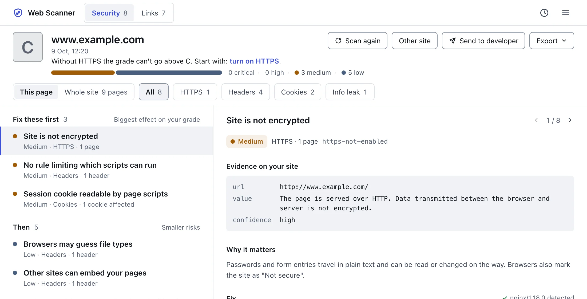

# Web Scanner website

Source of [webscanner.onderbakir.com](https://webscanner.onderbakir.com): the website, guide, privacy policy, terms and support link for Web Scanner, a Chrome extension that finds broken links and checks a site's security basics.

The extension's own source code is not in this repository. Install Web Scanner from the [Chrome Web Store](https://chromewebstore.google.com/detail/pnnfoicflgjgmomkaeopjidbbejejipm).



## Web Scanner in short

- **Free:** link scans of up to 150 URLs each, every broken link with its page and link text, redirect chains, a security grade and the full issue list. Fixes are not included, apart from one sample finding from a demo scan.
- **Pro Lifetime:** a one-time payment of $9.99 through Lemon Squeezy. No URL limit, the evidence and fix for every finding (fix code for Nginx, Apache, Cloudflare, Next.js, Vite, Express and PHP), scan history with rescan comparison, client reports, CSV and JSON export. One license works in up to 5 browsers.
- Runs in Chrome 116 or newer. Scans run in the browser; there is no account, analytics or ads in the extension.

## Pages

| File | Live path | What it is |
| --- | --- | --- |
| `index.html` | `/` | Product page: how it works, pricing, privacy summary, FAQ |
| `guide.html` | `/guide` | User guide for 1.3: first scan, broken links, security grade, fixes and reports, license, troubleshooting |
| `changelog.html` | `/changelog` | Release notes for 1.2.0 to 1.3.1 |
| `privacy.html` | `/privacy` | Privacy policy of the extension and the website |
| `terms.html` | `/terms` | Terms of use, Free and Pro, refunds |
| `404.html` | any unknown path | Not-found page |

Other files: `style.css` (shared stylesheet), `fonts/` (self-hosted Space Grotesk, Inter and JetBrains Mono with their OFL licenses), `icon.png`, `og.png` (1200×630 social preview image), `img/` (screenshots and the video poster on the home page), `demo.mp4` (product demo video, no sound), `_headers` (security and cache headers), `sitemap.xml` and `robots.txt`.

## Run locally

There is no build step. The site is plain HTML and CSS, so any static server works:

```sh
python3 -m http.server 8000
```

Then open http://localhost:8000. Links use extensionless paths such as `/guide`, which a plain static server does not resolve: open `/guide.html` instead. Extensionless paths, `404.html` for unknown paths and `_headers` are handled by Cloudflare Pages.

## Deploy

The site is hosted on Cloudflare Pages, connected to this repository. A push to `main` deploys to production at webscanner.onderbakir.com. There is no build command; the repository root is served as is. Pushes to other branches get preview deployments.

When you change `style.css`, raise the `?v=` value in the stylesheet link of every page, so browsers that cached the old file fetch the new one.

## Report a bug

Open an issue at [github.com/onder007/web-scanner/issues](https://github.com/onder007/web-scanner/issues), for the website or the extension. Questions about a Pro purchase or a refund: reply to your Lemon Squeezy receipt email.
